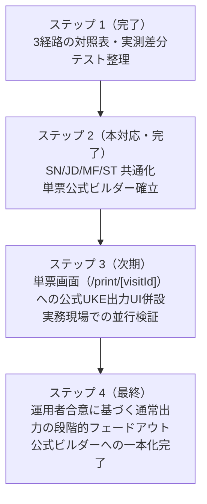

# トラック C-1 ステップ 2：通常 UKE と公式提出用 UKE の内部生成経路統合に向けた計画・設計報告書

**作成日**: 2026年9月30日  
**対象**: レセプト電算処理システム（UKE）生成基盤  
**関連コミット**: ステップ 1（`1578df5`）、ステップ 2（本対応）

---

## 1. 目的と背景

ステップ 1（[docs/uke_generation_paths_comparison_20260930.md](file:///Users/takeaki/pharma-oss/docs/uke_generation_paths_comparison_20260930.md)）において、pharma-oss 内に存在していた 3 つの UKE 出力経路（単票通常、月次通常、月次公式提出）の対照表を整理し、実測テストおよび比較スクリプトにより構造的・規約的な差分を明確化した。

主な相違点として：
1. **ST レコードのセマンティクス衝突**: 通常出力が薬歴タイムスタンプ保持に `ST,タイムスタンプ,yakureki` を流用していたのに対し、公式仕様における `ST` は「医師指示分割調剤情報」レコードである。
2. **フッターと終端規約**: 通常出力は `GO` レコードを持たず CRLF テキストで終わるが、公式提出仕様は必ず `GO` レコード（件数、合計点数、99）およびバイナリ末尾 `0x1A`（EOF）を要求する。
3. **補助レコード（SN / JD / MF / ST）の有無**: 特別公費、日別調剤日、窓口負担額、分割調剤などの条件付き公式レコードが月次生成モジュール内に閉じていた。

本ステップ 2 では、「公式ビルダを唯一の正規生成経路にする」長期方針のもと、**基盤ロジックの共通化と単票公式生成ビルダーの部品化**を実施した。

---

## 2. 実施した共通化・設計アーキテクチャ

### 2.1 補助レコード生成の共通モジュール化（`dispensing_uke_official_supplemental.ts`）

月次公式ビルダー（`monthly_claim_uke.ts`）に埋め込まれていた条件付き補助レコード生成処理を、純粋関数として抽出・共通化した。

- **`buildOfficialDailyFields`**: 1日〜31日の日別記録（JD/MF用）をパディング付きで正確にフォーマット。
- **`buildOfficialSupplementalRecords`**: 特別公費等補助情報（`SN` レコード）。主保険（HO）または公費（KO）の存在を必須ガードし、不正な単独出力を物理的に遮断。
- **`buildOfficialDispensingDateRecords`**: 日別調剤日情報（`JD` レコード）。
- **`buildOfficialCopaymentRecords`**: 日別窓口負担額情報（`MF` レコード）。全項目定義に準拠した2桁区分コードおよび9桁パディング金額の出力。
- **`buildOfficialSplitDispensingRecords`**: 医師指示分割調剤情報（`ST` レコード）。処方月日・調剤月日・受付回・分割回・点数を正確に記録。

これにより、月次公式生成と単票公式生成の両方が同一の補助レコード契約を共有できるようになった。

### 2.2 単票公式生成ビルダー（`dispensing_uke_official_single.ts`）の確立

単票（1件の受付データ）から公式提出仕様の UKE ファイル（`RECEIPTY.CYO`）を生成する `buildSingleDispensingUkeOfficial` を新設した。

```typescript
export interface SingleDispensingUkeOfficialResult {
  fileName: string; // 'RECEIPTY.CYO'
  content: Uint8Array; // Shift_JIS エンコード + 終端 0x1A
  text: string; // CRLF 連結テキスト（デバッグ・プレビュー用）
  records: UkeRecord[];
  totalClaims: 1;
  totalPoints: number;
  readinessReport: MonthlyClaimUkeOfficialReadinessReport;
  bundle: MonthlyClaimOfficialUkeBundle;
}
```

#### 設計の特徴と安全性:
1. **二重実装の完全排除**:
   - `buildMonthlyClaimUkeResults([claim])` および `buildMonthlyClaimOfficialUkeBundle([claim], results)` を直接呼び出すアーキテクチャを採用。
   - 公式仕様の改定、バリデーションルール、照合レポート（`officialReconciliationReport`）の更新が、月次と単票の双方に即時かつ均一に適用される。
2. **GO レコードと終端規約の完全準拠**:
   - 単票であっても末尾に `GO,1,{totalPoints},99` が付与される。
   - バイナリ末尾に `0x1A` が確実に付与される。
3. **安全保護設計（未記録の推測補完禁止）**:
   - 事前準備レポート（`readinessReport`）でレセ電医薬品コードや調剤料コードの欠落が検知された場合、推測で補完せず即座にエラーを送出し、不正な公式レセプトの出力を防止する。

---

## 3. 並行運用方針と今後の移行計画（ロードマップ）

既存の単票通常出力（`/print/[visitId]` や薬歴ダウンロード）は、現場の現行運用（タイムスタンプ付き通常形式の利用）に依存しているため、**独断で直ちに廃止・切替を行ってはならない（AGENTS.md 第七条・第十条遵守）**。

今後の移行ステップは以下の通り計画する：



- **ステップ 3**:
  - 単票画面（`/print/[visitId]`）において、既存の通常出力ボタンに加えて「公式提出用 UKE（RECEIPTY.CYO）プレビュー・ダウンロード」機能を併設する。
  - 運用者が両形式を比較・点検できる UI/UX を提供する。
- **ステップ 4**:
  - 実運用での検証と現場薬剤師・医療事務担当者との合意を経て、公式生成経路への一本化を完了する。

---

## 4. 厳格な検証結果（honest-verification 準拠）

| 検証項目 | コマンド / 手法 | 結果 | 備考 |
| :--- | :--- | :--- | :--- |
| **TypeScript 型検査** | `npx tsc --noEmit` | **0 errors** | 型の完全性を単独確認 |
| **補助レコード単体テスト** | `npx tsx --test src/lib/receipt/dispensing_uke_official_supplemental.test.ts` | **5 pass / 0 fail** | 純粋関数直接インポートによる実地テスト |
| **補助レコード変異テスト** | `SN` レコード種別を変異注入 | **1 fail（検知成功）** | テストの真正性を実証後に復元 |
| **単票公式生成テスト** | `npx tsx --test src/lib/receipt/dispensing_uke_official_single.test.ts` | **3 pass / 0 fail** | GO/0x1A/補助レコード/エラーガードの完全検証 |
| **単票公式生成変異テスト** | `totalClaims` を変異注入 | **1 fail（検知成功）** | テストの真正性を実証後に復元 |
| **既存月次テスト** | `npx tsx --test src/lib/monthly_claim_uke.test.ts` | **42 pass / 0 fail** | 委譲リファクタリング後の完全互換性確認 |
| **3経路差分テスト** | `npx tsx --test src/lib/receipt/dispensing_uke_comparison.test.ts` | **3 pass / 0 fail** | 差分検出仕様の非破壊性を確認 |
