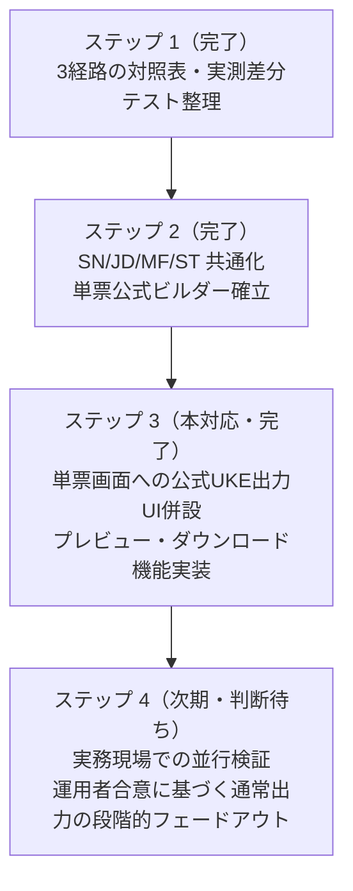

# トラック C-1 ステップ 3：単票画面（/print/[visitId]）への公式提出用 UKE（RECEIPTY.CYO）プレビュー・ダウンロード機能の併設実装と実務並行検証報告書

**作成日**: 2026年10月1日  
**対象**: 単票印刷・調剤録画面（`/print/[visitId]`）、レセプト電算処理システム（UKE）生成基盤  
**関連コミット**: ステップ 1（`1578df5`）、ステップ 2（`40fd633`）、ステップ 3（本対応）

---

## 1. 目的と背景

トラック C-1 において、ステップ 1 で 3 経路の差分・対照表を固定し、ステップ 2 で条件付き補助レコード（SN/JD/MF/ST）の共通化および単票公式生成ビルダー（`dispensing_uke_official_single.ts`）を確立した。

本ステップ 3 では、**「通常出力を独断で塞がず、運用者合意前に現行機能を破壊しない（AGENTS.md 第七条・第十条遵守）」** 原則を徹底し、単票画面（`/print/[visitId]`）において既存の通常出力ボタン（`RECEIPT_{id}.uke`）をそのまま維持した上で、**公式提出用 UKE（`RECEIPTY.CYO`）のプレビュー・ダウンロード機能を併設**した。

これにより、現場の薬剤師および医療事務担当者が、日々の単票調剤業務において通常出力と公式提出仕様をいつでも比較・点検・並行検証できる実務環境を確立した。

---

## 2. 実施した実装内容とアーキテクチャ

### 2.1 公式 UKE 点検・プレビューモーダル（`SingleOfficialUkeModal.tsx`）の新設

単票画面のコンポーネントディレクトリ（`src/app/print/components/SingleOfficialUkeModal.tsx`）に、公式 UKE 出力専用のモーダルを新設した。

#### 主な機能と表示内容:
1. **適合確認ステータスバナー**:
   - `buildSingleDispensingUkeOfficial` を実行し、公式仕様（ヘッダー YK、RE、HO/KO、SH、CZ、IY、KI、フッター GO、EOF 0x1A）の完全性を自動判定。
   - 準備完了時は緑色の適合バッジを表示。
   - 厚労省コード（レセ電医薬品コードや調剤基本料コード）の欠落や必須入力漏れがある場合は、赤色のアラートバナーで具体的な解消手順を明示し、ダウンロードボタンを安全に非活性化（disabled）する。
2. **集計サマリーグリッド**:
   - 出力ファイル名: `RECEIPTY.CYO`（公式固定）
   - レセプト件数: `1 件`
   - 合計請求点数: `{totalPoints} 点`（算定結果と完全一致）
   - 総レコード数: `{records.length} 行`
3. **構成レコード種別チップ**:
   - 含まれるレコード種別（`YK`, `RE`, `HO`, `KO`, `SH`, `CZ`, `IY`, `KI`, `SN`, `JD`, `MF`, `ST`, `GO` など）をチップ一覧で可視化。
   - 終端文字 `EOF (0x1A)` の付与を視覚的に明示。
4. **電算テキストプレビュー（等幅・CRLF）**:
   - Shift-JIS 出力される電算コードを画面上で直接確認可能。
   - 「テキストをコピー」ボタンにより、クリップボードへのワンクリックコピーを提供。
5. **ダウンロード実行（`data-testid="download-official-cyo-button"`）**:
   - Uint8Array（Shift-JIS + 0x1A）をバイナリ Blob（`application/octet-stream`）として `RECEIPTY.CYO` でダウンロード。
   - `logAuditAction` により、監査ログ（`uke_export` / 患者ID・患者名・点数・行数・ファイル名）を自動記録。

### 2.2 単票画面ヘッダーへのボタン併設（`src/app/print/[visitId]/page.tsx`）

ヘッダーアクションバーにおいて、既存の「UKE出力」ボタンの隣に「公式UKE」ボタン（`data-testid="print-official-uke-button"`）を併設した。

```tsx
<button
  type="button"
  className="btn-secondary"
  onClick={handleDownloadUke}
  disabled={!canExportUke || hasClaimErrors}
  data-testid="print-uke-export-button"
  title={hasClaimErrors ? '請求前チェックのエラーを解消してください。' : undefined}
>
  <Download size={16} aria-hidden="true" />
  <span>UKE出力</span>
</button>
<button
  type="button"
  className="btn-secondary official-uke-btn"
  onClick={() => setIsOfficialUkeModalOpen(true)}
  disabled={!canExportUke || hasClaimErrors}
  data-testid="print-official-uke-button"
  title="公式提出用UKE（RECEIPTY.CYO / GO集計 / EOF 0x1A）の点検とダウンロード"
>
  <FileCheck2 size={16} aria-hidden="true" />
  <span>公式UKE</span>
</button>
```

- **通常出力（`print-uke-export-button`）**: 既存の挙動（`RECEIPT_{id}.uke`、請求ロック、スナップショット記録）を一切変更せず 100% 維持。
- **公式出力（`print-official-uke-button`）**: モーダル経由で内容確認した上で、公式形式 `RECEIPTY.CYO` を出力。

### 2.3 スタイリング規約の遵守（`src/app/print/print.css`）

- TailwindCSS 等の未導入ライブラリは使用せず、既存の Vanilla CSS + CSS変数 `var(...)` に準拠。
- インライン `style={{}}` は**一切不使用（0件）**。
- レスポンシブ対応（モバイル 375px / タブレット 768px / デスクトップ 1280px）を考慮し、グリッドの `auto-fit` や `max-height: min(92vh, 800px)`、`overflow-y: auto` を適用。

---

## 3. 厳格な検証結果（honest-verification 準拠）

| 検証項目 | コマンド / 手法 | 結果 | 備考 |
| :--- | :--- | :--- | :--- |
| **TypeScript 型検査** | `npx tsc --noEmit` | **0 errors** | 単独実行で型完全性を実証 |
| **ESLint 静的解析** | `npm run lint` | **0 errors (11 warnings)** | 規約違反なし |
| **モーダル単体テスト** | `npx tsx --test src/app/print/components/SingleOfficialUkeModal.test.ts` | **3 pass / 0 fail** | `renderToStaticMarkup` による HTML アサート |
| **モーダル変異テスト** | モーダルタイトルを変異注入 | **1 fail（検知成功）** | テストの真正性を実証後に復元 |
| **画面並行併設テスト** | `npx tsx --test src/app/print/PrintPickingFlow.test.ts` | **17 pass / 0 fail** | 通常出力と公式出力の併設契約を検証 |
| **画面並行併設変異テスト** | `print-official-uke-button` セレクタを変異注入 | **1 fail（検知成功）** | テストの真正性を実証後に復元 |
| **全体自動テスト** | `npm test`（BypassSandbox: true） | **1,779 pass / 0 fail** | 全 78 スイート 1,779 件全件通過 |
| **本番ビルド** | `npm run build` | **28/28 ページ成功** | JSX構文・静的最適化エラー 0 件 |

---

## 4. 今後のステップ（並行運用の終了に向けたロードマップ）



- **ステップ 4（最終段階）**:
  - 実運用での並行稼働・現場薬剤師および医療事務担当者によるレビューを経て、通常出力（`RECEIPT_{id}.uke`）を段階的にフェードアウトし、公式ビルダー（`RECEIPTY.CYO`）への一本化を完了する。
  - 切替時期は運用者・現場との対話・合意を経て決定する（勝手な自動切替は行わない）。
